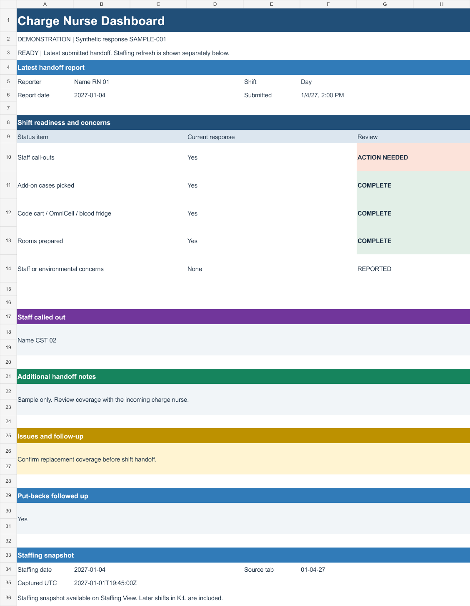
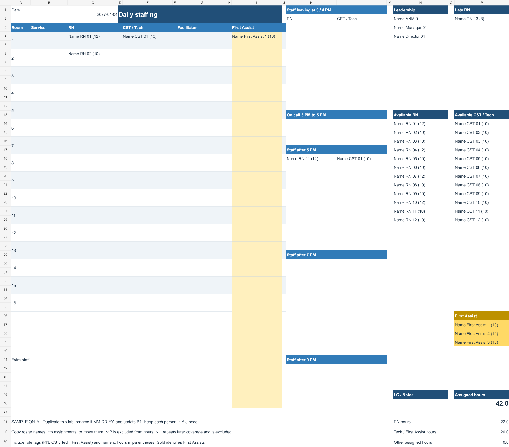
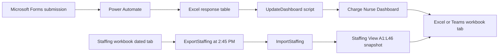

# Charge Nurse Handoff Dashboard

Bring the latest charge nurse handoff and the next staffing assignment sheet into one Excel workbook. Leaders can see call-outs, named staff, equipment checks, add-on readiness, room preparation, issues and comments, then open the complete staffing view, including later shifts.

**Start with [the setup guide](docs/SETUP.md).** This package contains clean templates and copy-ready Office Scripts. You select your own Microsoft Forms, workbooks and connections once. Power Automate then runs the updates in your Microsoft 365 environment. Copilot is optional.

Created by Nicholas DeStefano. This is an independent reusable project, not an official Microsoft or healthcare organization product.

## What it looks like

The dashboard uses a separate timestamp for the handoff response and the staffing snapshot. Missing answers remain **Not reported**, so an unanswered question does not look completed.

This example is generated with placeholder responses. The downloadable dashboard starts with an empty response table. [See the blank dashboard](assets/dashboard-template.png).

The staffing template retains the full **A1:L46** assignment area. Nurses, CSTs, other techs, facilitators and First Assists have clear placement. First Assists appear in gold at the bottom of the tech roster. Leadership has its own section. All names are placeholders.

## Download the templates

| File | Purpose |
| --- | --- |
| [Charge Nurse Dashboard.xlsx](templates/Charge%20Nurse%20Dashboard.xlsx) | Dashboard, staffing view, empty response table and editable question map |
| [Staffing Assignments.xlsx](templates/Staffing%20Assignments.xlsx) | Dated assignment sheet with placeholder staff and assigned-hour calculations |
| [Charge Nurse Handoff Report.docx](templates/Charge%20Nurse%20Handoff%20Report.docx) | Printable yes/no and comment form, also a question reference for Microsoft Forms |

Open a file above and select **Download raw file**. Or use **Code > Download ZIP** to obtain the whole package. Excel files do not contain embedded Office Scripts or saved cloud credentials. Install the scripts using the guide.

## How the updates work

| Update | Default behavior | What readers should expect |
| --- | --- | --- |
| New handoff | Forms trigger, add row, wait 30 seconds, run dashboard script | Updates after the flow completes, not instant streaming |
| Staffing | Weekdays at 2:45 PM in the chosen local time zone | Next weekday; Friday selects Monday |
| Date override | Select `same-date` or `explicit-date` | Imports the requested date, including weekends if chosen |
| Later staffing edits | Run the staffing flow again, or configure the optional refresh schedule | Existing snapshots do not change merely because the source was edited |
| Teams | Displays the same cloud workbook | Teams is the viewing surface; Power Automate performs the updates |

## Requirements and costs

The documented route uses **standard Microsoft Forms and Excel Online (Business) connectors**, not premium connectors. An eligible Microsoft 365 business license, Office Scripts availability, Power Automate rights and your organization's permission are still required. A separate Copilot subscription is not needed for these scripts. See [licensing and restricted environments](docs/LICENSING.md) before setup.

## Adapt it to your unit

1. Copy the two Excel templates into your organization's SharePoint or OneDrive for Business.
2. Replace placeholder names and keep role tags and hours, for example `Name RN 01 (10)` or `Name CST 01 (8)`.
3. Create your Form using the [question catalog](docs/QUESTIONS.md), or connect an existing response table.
4. Edit the **Setup** sheet to match your column headers, dashboard labels and alert rules. Questions can be disabled, replaced or added to the detail section.
5. Follow [SETUP.md](docs/SETUP.md) to connect the handoff and staffing flows, then [add the workbook to Teams](docs/TEAMS.md).

The original combined code cart / OmniCell / blood fridge question is included. Units that need independent confirmation should split it into three questions. The [customization guide](docs/CUSTOMIZATION.md) explains how.

## Validation and project status

Version **0.1.0, private review package**. Automated local tests cover date selection, late response visibility, timestamps, field mapping, source preservation, snapshot shape and older snapshot rejection. Both workbooks opened in desktop Excel. A cut-and-paste test changed hours from 42 to 52 when a placeholder nurse was assigned, and back to 42 when moved out. Workbook and Word layouts were visually reviewed.

**The flows still require a test in the adopting organization's Microsoft 365 tenant.** Local tests do not prove tenant permissions, connector behavior or Teams refresh timing. Use the acceptance test in the setup guide before relying on the dashboard for handoff.

Developers can run `npm test` with Node.js 24 or newer. No packages need to be installed. Node.js is only for tests; leaders use Excel and Power Automate.

| Guide | Use it for |
| --- | --- |
| [Setup](docs/SETUP.md) | The complete standard-connector installation |
| [Questions](docs/QUESTIONS.md) | Form wording, types and Excel column names |
| [Customization](docs/CUSTOMIZATION.md) | Existing Forms sheets, local time handling and different questions |
| [Staffing rules](docs/STAFFING.md) | Dates, assignments, hours and ongoing refresh |
| [Teams](docs/TEAMS.md) | Shared viewing and operational ownership |
| [Troubleshooting](docs/TROUBLESHOOTING.md) | Manual success but automatic failure, stale data and mapping errors |

MIT licensed. Keep operational workbooks, real staff lists, response exports and credentials in your organization's approved storage, outside this repository. The supplied templates were rebuilt with placeholders and do not include the source workbooks' hidden sheets, connections or response history.
